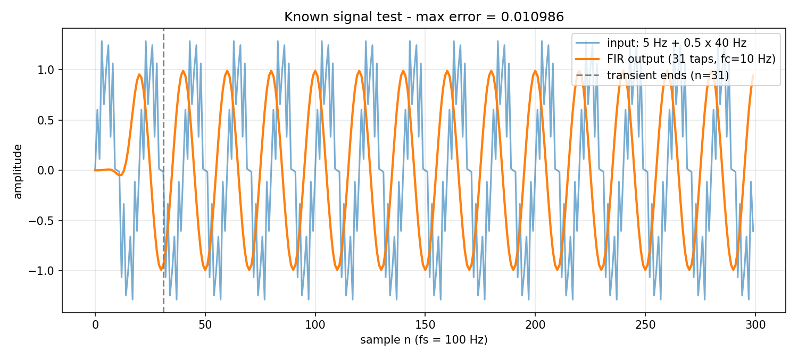
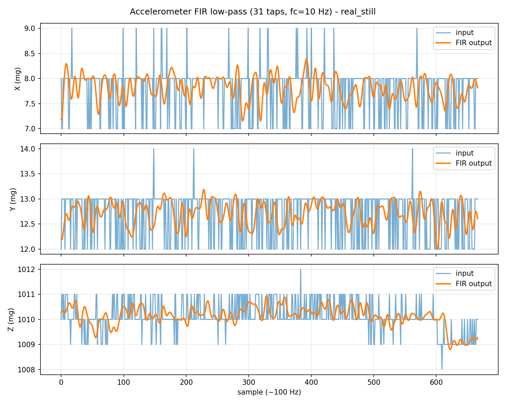
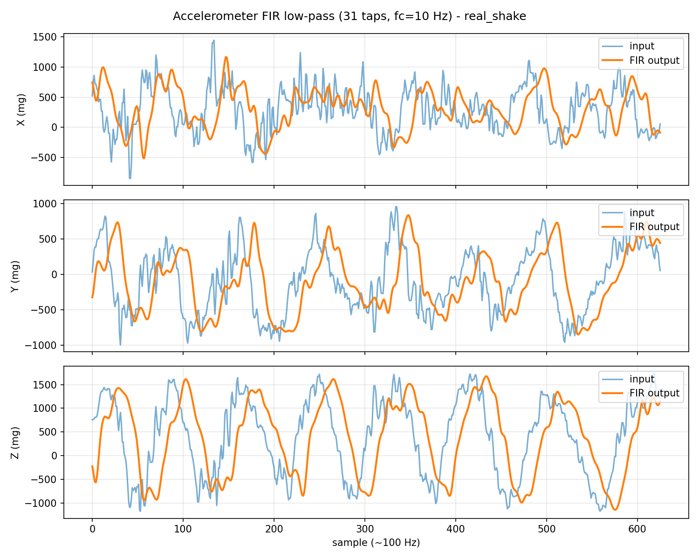

# HW-Lab7: CMSIS-DSP Programming

## Team

- 莊凱皓 (r15922131)
- 王昱鈞 (r15922162)

## Board

STM32 B-L475E-IOT01A1 (STM32L475VGTx, Cortex-M4F with FPU), STM32CubeIDE / CubeMX, CMSIS-DSP

## Overview

A 31-tap FIR low-pass filter built with CMSIS-DSP (`arm_fir_f32`), applied to the 3-axis accelerometer (LSM6DSL) of the IoT node. Before using real sensor data, the filter is verified with a known synthetic signal.

| Item | Value |
|------|-------|
| Sampling rate (fs) | 100 Hz |
| FIR taps | 31 |
| Cutoff frequency | 10 Hz |
| Coefficients | `scipy.signal.firwin(31, 10, fs=100)` (`Core/Inc/fir_coeffs.h`) |
| Output | USART1 (ST-LINK virtual COM port), 115200 baud |

## Part 1: Known-signal verification

Set `#define USE_KNOWN_SIGNAL 1` in `Core/Src/main.c`.

Input is a 300-sample signal: 5 Hz sine (to keep) + 0.5 x 40 Hz sine (to remove). The first 31 samples (transient) are skipped, then the output is compared with the ideal 5 Hz sine delayed by 15 samples (group delay = (31-1)/2).

| Item | Value |
|------|-------|
| Max error | 0.010986 (target <= 0.05) |

Capture: `python tools/capture_plot.py COM8` -> `results/known_signal.csv/.png`

## Part 2: Real accelerometer data

Set `#define USE_KNOWN_SIGNAL 0`. Each axis has its own `arm_fir_instance_f32`. The firmware reads `BSP_ACCELERO_AccGetXYZ()` (mg), filters it, and prints `in_x,in_y,in_z,out_x,out_y,out_z` as CSV.

Capture: `python tools/capture_plot_real.py COM8 10 <name>` -> `results/<name>.csv/.png`

Board at rest:

Board shaken by hand:

## Build

1. Open `HW-Lab7-DSP.ioc` in STM32CubeMX (USART1 = Asynchronous 115200, I2C2 disabled because the BSP defines `hi2c2`).
2. Import the project into STM32CubeIDE and build (Debug).
3. Flash with Run, then open a serial terminal (e.g. PuTTY) on the ST-LINK COM port at 115200.

Notes:
- `HAL_I2C_MODULE_ENABLED` must be enabled in `Core/Inc/stm32l4xx_hal_conf.h`; re-enable it after every CubeMX regenerate.
- CMSIS-DSP sources are in `Drivers/CMSIS/DSP` (only `arm_fir_f32.c` and `arm_fir_init_f32.c`), with include paths `../Drivers/CMSIS/DSP/Include`, `../Drivers/CMSIS/DSP/PrivateInclude` and the symbol `ARM_MATH_CM4`.
- Linker flag `-u _printf_float` is required for float `printf`.

## Project structure

- `Core/` - application code (`main.c`) and `fir_coeffs.h`
- `Drivers/` - HAL, BSP (accelerometer) and CMSIS-DSP
- `tools/gen_fir_coeffs.py` - generates the FIR coefficients
- `tools/capture_plot.py`, `tools/capture_plot_real.py` - serial capture and plotting (needs `pyserial`, `numpy`, `scipy`, `matplotlib`)
- `results/` - captured CSV files and plots

## Known limitations

- In real-data mode the loop uses `HAL_Delay(10)` plus the I2C read and UART transmit time, so the actual sampling rate is about 62-67 Hz instead of 100 Hz. The effective cutoff frequency is therefore lower than 10 Hz. The known-signal test uses synthetic samples at exactly 100 Hz and is not affected.
